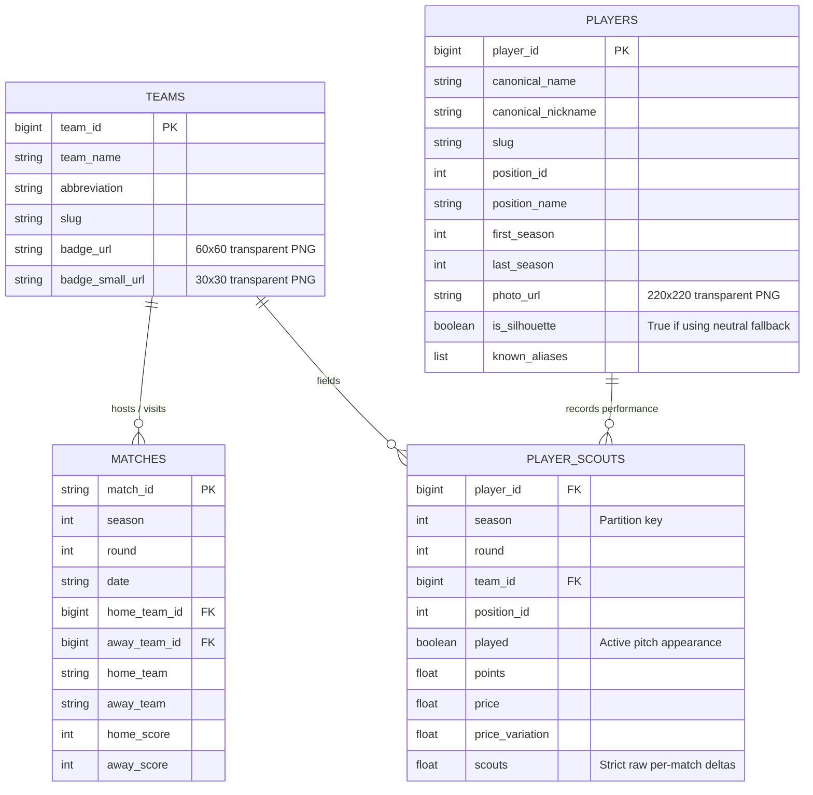

# CLT Data Pipeline Memo & Architecture Specification

**Project:** CLT (Fantasy Soccer / Football Game Engine)  
**Location:** `C:\Users\thiag\Documents\CLT\`  
**Date:** October 2026  
**Status:** Ingestion & Normalization Complete (100% Relational Integrity Verified)

---

## 1. Executive Summary

This pipeline ingests, cleans, harmonizes, and validates 12 seasons (**2014–2025**) of the Campeonato Brasileiro Série A from Cartola FC raw historical datasets (`henriquepgomide/caRtola`) and William Amorim's Brasileirão match repository. 

All entities are exported into columnar **Apache Parquet** format with full relational integrity, 0 missing foreign keys, 0 orphan records, 0 mojibake encoding artifacts, and official transparent PNG visual assets (player cutout headshots, fallback silhouettes, and club crests).

---

## 2. Relational Schema & Asset Specifications



### Table Details (`C:\Users\thiag\Documents\CLT\data\`)

| Table / Directory | File Path | Records | Key Schema & Notes |
| :--- | :--- | :---: | :--- |
| **`teams.parquet`** | `data/teams.parquet` | 39 clubs | `team_id` (PK, int64), `team_name`, `abbreviation`, `slug`, `badge_url` (60x60 PNG), `badge_small_url` (30x30 PNG). Covers 100% of Serie A clubs (Paraná aligned to Cartola ID `289`). |
| **`matches.parquet`** | `data/matches.parquet` | 4,560 matches | Exactly 380 matches/season (2014–2025). 0 null `home_team_id` or `away_team_id` values. Includes `home_score`, `away_score`, and match date. |
| **`players.parquet`** | `data/players.parquet` | 4,631 players | Keyed by persistent Globo `player_id`. Includes `photo_url` (`220x220` cutout headshot for 3,223 players $\ge 2017$; official neutral silhouette for 1,408 legacy/unphotographed players), `is_silhouette` (`bool`), clean canonical names, and career spans. |
| **`player_scouts/`** | `data/player_scouts/season=YYYY/data.parquet` | 359,385 rows (131,660 active) | Hive-partitioned by `season=2014` through `season=2025`. Strictly isolated per-fixture scouts (no cumulative bleed). 0 primary key duplicates; 0 unmapped `team_id`s. |

---

## 3. Visual Asset CDN Architecture

* **Player Cutout Headshots (`photo_url`):**
  * Stored on Globo's media CDN: `https://s.glbimg.com/es/sde/f/..._220x220.png` or `https://s.sde.globo.com/media/person_role/.../photo_220x220_....png`.
  * The raw data stores a `FORMATO` template, dynamically converted to `220x220` transparent PNG.
* **Neutral Player Silhouette:**
  * For legacy players (retired $\le 2016$) or unphotographed players:  
    `https://s3.glbimg.com/v1/AUTH_58d78b787ec34892b5aaa0c7a146155f/clubes_2026/silhuetas/OUT/220x220.png`
* **Team Escudos (`badge_url` & `badge_small_url`):**
  * Harvested directly from the live Cartola FC API (`https://api.cartola.globo.com/clubes`).
  * High-contrast transparent PNGs in `60x60` and `30x30` dimensions.

---

## 4. Pipeline Execution Order (`C:\Users\thiag\Documents\CLT\pipeline\`)

When rebuilding or adding new seasons, execute the scripts in the following order:

```bash
# 1. Build canonical clubs and match fixtures (2014-2025)
python 01_build_teams_and_matches.py

# 2. Extract player scouts and apply selective de-accumulation
python 02_extract_player_scouts.py

# 3. Finalize active pitch appearance flag (played == True)
python 03_finalize_played_flag.py

# 4. Build Global Player Dictionary with photos, silhouettes, and aliases
python 04_build_players_dictionary.py

# 5. Run full QA validation suite
python qa_integrity_check.py
python qa_verify_spot_checks.py
```

---

## 5. Critical Technical Nuances & Learnable Pills

1. **Selective De-Accumulation (Cumulative vs. Fixture-Level):**
   * **2014 & 2016:** Scouts were stored at **fixture-level** in raw files; differencing them corrupts the counts.
   * **2015 & 2017–2025:** Scouts were stored **cumulatively** across rounds; must be differenced via `.groupby(player_id)[scouts].diff().fillna(...)`.
2. **Hybrid Club ID Resolution:**
   * In 2017 and 2018, `caRtola` raw dumps stored club names/abbreviations as strings (e.g. `"Cruzeiro"` or `"CRU"`) rather than integer IDs. The pipeline applies a hybrid string-to-canonical-ID resolver with per-player forward/backward filling for transfer disambiguation.
3. **Encoding & Byte Sanitation:**
   * UTF-8 double/triple encoding must be resolved *prior* to stripping ASCII control bytes (`\x80-\x9f`), because uppercase accented UTF-8 characters (`Í`, `É`, `Ó`, `Ñ`, `Ç`) share the second byte with the C1 control block.
4. **Greedy Set-Cover for Snapshot Harvesting:**
   * Rather than sequentially pulling 304 round CSVs across 8 seasons, the pipeline computes a greedy set-cover from the local `player_scouts` table, pulling only **74 minimal round snapshots** in parallel to guarantee 100% coverage of all 4,631 players in seconds.
